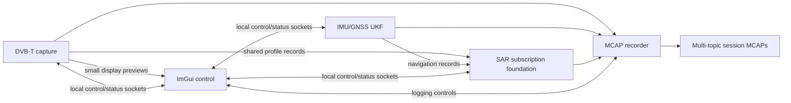

# PL64 NixOS

The remote builder is `daniel@daniel-ubuntu-vm.local`, an x86_64 Ubuntu VM.
The Mac uses ordinary SSH, rsync and scp; no local Nix installation or
shell-profile changes are needed.

The temporary EC2 builder and its 100 GiB disk were deleted on 20 October 2026.
The tested installer remains in `artifacts/`. Builds now run on the Ubuntu VM;
the installed PL64 can also build its own configuration updates.

Run the following Mac commands from this repository:

```sh
cd /Users/danielrd/sources/pl64-nix
```

## Connect

```sh
ssh daniel@daniel-ubuntu-vm.local
```

On the builder:

```sh
cd ~/pl64
nix --version
```

## Set up Nix on a fresh Ubuntu builder

From the Mac:

```sh
ssh daniel@daniel-ubuntu-vm.local 'mkdir -p ~/pl64/builder'
scp builder/bootstrap.sh daniel@daniel-ubuntu-vm.local:pl64/builder/bootstrap.sh
ssh -t daniel@daniel-ubuntu-vm.local \
  'sudo bash /home/daniel/pl64/builder/bootstrap.sh daniel'
```

Enter the Ubuntu user's sudo password in the terminal. The script installs
the official multi-user Nix daemon, enables flakes and sets four concurrent
build jobs with two cores each. Open a fresh SSH session afterward so the
official shell setup adds Nix to `PATH`. Normal builds need no sudo.

If VMware's virtual disk has been enlarged, inspect `lsblk` and `df -h /`
inside Ubuntu. On this VM, the disk is `/dev/sda` and root is ext4 on
partition 2; expand the partition and filesystem with:

```sh
sudo growpart /dev/sda 2
sudo resize2fs /dev/sda2
df -h /
```

## Sync local sources to the builder

Run on the Mac after editing files:

```sh
rsync -az \
  --exclude='/builder/' --exclude='/.git/' \
  --exclude='/artifacts/' --exclude='/result*' --exclude='.DS_Store' \
  ./ daniel@daniel-ubuntu-vm.local:/home/daniel/pl64/
```

## Build

Run on the builder:

```sh
cd ~/pl64
nix build .#installer-iso -L -o result-iso
```

To build only the installed system closure:

```sh
nix build .#system -L -o result-system
```

## Download the ISO to the Mac

```sh
mkdir -p artifacts
scp 'daniel@daniel-ubuntu-vm.local:/home/daniel/pl64/result-iso/iso/*.iso' artifacts/
```

To bring a remotely generated lock file into the repository:

```sh
scp daniel@daniel-ubuntu-vm.local:/home/daniel/pl64/flake.lock ./
```

## Install on the PL64

Write the ISO as an image to a USB stick, then boot its UEFI entry. The image is
unsigned, so disable Secure Boot. Ethernet uses DHCP; use `nmtui` for Wi-Fi.
The live console logs in as root. SSH accepts the public key in `keys/root.pub`.
Nothing is installed automatically, and the installer needs no internet access.

Identify the intended NVMe disk by model, capacity and serial number:

```sh
lsblk -o NAME,SIZE,MODEL,SERIAL,MOUNTPOINTS
test -d /sys/firmware/efi/efivars
```

The following commands erase the selected disk. Set `PL64_DISK` to the intended
NVMe device before running them. The layout is a 1 GiB EFI partition followed
by an unencrypted ext4 root partition occupying the remaining space.

```sh
PL64_DISK=/dev/nvme0n1
parted --script "$PL64_DISK" mklabel gpt \
  mkpart ESP fat32 1MiB 1025MiB set 1 esp on \
  mkpart root ext4 1025MiB 100%
udevadm settle
mkfs.fat -F 32 -n PL64_EFI "${PL64_DISK}p1"
mkfs.ext4 -L PL64_ROOT "${PL64_DISK}p2"
mount -t ext4 "${PL64_DISK}p2" /mnt
mkdir -p /mnt/boot /mnt/etc/nixos
mount -t vfat "${PL64_DISK}p1" /mnt/boot
cp -rL /etc/pl64-config/. /mnt/etc/nixos/
chmod -R u+w /mnt/etc/nixos
nixos-install --root /mnt --no-channel-copy \
  --system "$(readlink -f /etc/pl64-system)"
```

Set a root password at the installer's prompt for local HDMI-console login.
SSH remains key-only. If installing through a non-interactive SSH session, set
the console password explicitly before rebooting:

```sh
nixos-enter --root /mnt -c passwd
umount -R /mnt
poweroff
```

Remove the USB stick and power the PL64 on. The installed system has HDMI text
consoles, NetworkManager, SSH, local man pages and standard administration,
network, storage and diagnostic tools. The source configuration provides on-demand
fullscreen SDR++ and radar control sessions on tty1. Neither GUI starts at boot.
It has no desktop environment or display manager.
Avahi advertises the installed system as `pl64.local` on the local network:

```sh
ssh root@pl64.local
```

The pinned kernel is Linux 7.2.11. Intel microcode, i915 graphics firmware,
Intel Wi-Fi/Bluetooth firmware and Intel audio-DSP firmware are included.
The initrd contains NVMe/VMD and USB keyboard support rather than the generic
SATA/RAID/storage collection. Intel HWP frequency scaling, CPU idle states,
normal ACPI/PCIe/NVMe power management and suspend are retained; thermald
handles the fanless system's Intel thermal policy. Zram supplies compressed
memory swap; disk hibernation is not configured.

Use BIOS 2.10.00 or newer: BIOS 1.16.00 exposed broken thermal tables and no
active policy in thermald's adaptive mode. After updating to 2.10.00, the
original `proc_thermal_add` error disappeared and the firmware supplies working
thermal and power tables. The installed system uses the NixOS thermald
service with `services.thermald.configFile` selecting its default engine.
The small profile in `nixos/thermal-conf.xml` leaves temperatures and limits
to the firmware: an active `TCPU` zone with a 90 C passive trip, a sustained
CPU-package limit of 15 W and a short-term limit of 39 W. Adaptive mode was
observed relaxing the MSR limit while the MMIO limiter remained disabled,
so it is avoided. No custom trip temperatures or service override is needed.

The systemd-boot menu waits one second. Networking does not block console
startup on DHCP or a missing cable. Hold Space during UEFI boot to enter the
boot menu if needed. On the PL64, inspect actual boot and power behavior with:

```sh
systemd-analyze
systemd-analyze critical-chain
nmcli device status
cpupower frequency-info
sensors
systemctl suspend
```

For live temperature and CPU power readings, run as root:

```sh
watch -n 1 sensors
turbostat --quiet --Summary \
  --show TSC_MHz,Busy%,Bzy_MHz,PkgTmp,PkgWatt,SysWatt --interval 2
powertop
```

`turbostat` reports CPU-package watts, temperatures, frequency and idle-state
residency (omit `--show` for all counters). `SysWatt` is the processor's platform
energy estimate. These readings do not measure total power at the wall. `powertop`
shows activity and tunables; its power estimates on an AC-only machine can be
unavailable. Firmware power limits and supported idle states remain enabled.

The 21 October 2026 check after BIOS 2.10.00 and a fresh boot measured about
3.7 W CPU-package power at idle. A 60-second CPU load initially drew about
24 W, then settled to 15 W after the boost window, with a peak package
temperature of 67 C and no CPU thermal throttling. The power limits remained
15 W sustained / 39 W short-term. This was a brief functional check, not a
thermal heat-soak test. These limits are configurable; a future performance
profile can raise the sustained limit while retaining thermal protection.

The previous processor-thermal initialization error is gone. The boot log
still contains a Wi-Fi-related ACPI `CNVW._DSM` / missing `WIST` message;
Wi-Fi connectivity and hostname SSH were verified working.

VM validation cannot establish physical HDMI output, Intel network/Wi-Fi
compatibility, actual PL64 boot latency or suspend/resume reliability.

## Update the installed system

After syncing configuration changes to `/etc/nixos` on the PL64:

```sh
ssh -t root@pl64.local 'nixos-rebuild switch --flake /etc/nixos#pl64'
```

Use this explicit flake workflow. The image omits legacy channels and the
implicit Nixpkgs source checkout; updates fetch the inputs pinned by
`flake.lock` when needed.

## IMU serial ports

The onboard Fintek serial ports have stable aliases `/dev/pl64com1` and
`/dev/pl64com2`. The IMU cable moved to **COM2** on 6 November 2026, at sensor
address `0x00`. `pl64-ins` owns that port and configures the IMU for 200 Hz
floating-point output at 460800 baud. Its device binding and udev permissions
follow `services.pl64-ins.settings.service.imu_device`.

`nixos/navigation.nix` applies the factory host format only to unused ports:
9600 baud, 8 data bits, no parity, one stop bit, raw I/O, no hardware/software
flow control or carrier-detect requirement. It does not run a competing stty
service on the port owned by acquisition.

```sh
stty -F /dev/pl64com1 -a
stty -F /dev/pl64com2 -a
systemctl status pl64-com1-settings pl64-ins
```

The IMU normally waits for a binary query rather than streaming on power-up.
The manufacturer's [digital protocol](https://www.analogtechnologies.com/document/Digital_Protocol.pdf)
documents an address query `77 04 00 1f 23` and a combined gyro/accelerometer
query `77 04 00 59 5d`. These are raw hexadecimal bytes, with no line ending.
Do not type their hexadecimal spelling into a terminal and expect a reply.

For a manual factory-mode query, first stop `pl64-ins` and ensure the sensor
is in query/response mode at 9600 baud. Do not run this against the live stream:

```sh
printf '\x77\x04\x00\x59\x5d' |
  socat -t 1 -T 1 - /dev/pl64com2,raw,echo=0,b9600,cs8,parenb=0,cstopb=0,crtscts=0,ixon=0,ixoff=0,clocal=1 |
  od -An -tx1
```

The response is 23 bytes beginning `77 16 00 84`: three signed BCD gyro
values in degrees/second, then three signed BCD acceleration values in g,
followed by the checksum. Run only one serial reader at a time.

On 21 October 2026, address, gyro, acceleration and combined queries all
returned valid checksums. A five-second check received 50/50 valid combined
responses at 10 polls/second. Mean gyro readings were approximately
`[0.005, -0.035, -0.042]` degrees/second, and acceleration was
`[0.0031, 0.0092, 1.0008]` g, consistent with a stationary, nearly level
sensor. Mean request-to-response time was 37.6 ms at 9600 baud; this is
communication latency, not a measurement of sensor latency. The earlier
silence was resolved by connecting the cable to the serial port. Diagnostic
logs are under `artifacts/navigation/`.

Further tests on 21 October 2026 verified continuous output at
5, 10, 20, 25, 50, 100, 200 and 500 Hz. At 460800 baud, both combined BCD
and combined floating-point output worked without checksum errors. The
500 Hz stream repeated six-axis values in a two/three-packet pattern,
giving about **200 distinct measurements per second**. The floating-point
packet counter advanced on every packet, including repeated measurements.
Output frequency therefore must not be mistaken for the internal sample rate.

The newer [BWSensing V4 protocol](https://www.bwsensing.com.cn/upload/userfile/IMU_VG_AH_MINS_%E6%95%B0%E5%AD%97%E8%BE%93%E5%87%BA%E5%8D%8F%E8%AE%AE%E6%89%8B%E5%86%8C.pdf)
documents these controls. Command numbers below omit framing, address and
checksum; they are not complete packets.

| Control | Command | Options / verified behavior |
| --- | --- | --- |
| Output frequency | `0x0c` | `0` = query mode; `1`–`8` = 5/10/20/25/50/100/200/500 Hz; all tested |
| Stream contents | `0x56` | `0` gyro, `1` acceleration, `2` combined BCD, `3` combined float; combined modes tested |
| Baud rate | `0x0b` | 2400–460800 with a non-monotonic option mapping; 9600 and 460800 tested |
| Read float sample | `0x70` | Six little-endian float32 values, followed by a four-byte BCD counter |
| Startup gyro zero calibration | Read `0xf8`, set `0xf7` | Readback was enabled (`1`); setter not exercised |
| Gyro zero calibration | `0x52` / `0x5a` | Documented calibration controls; not exercised |
| Save settings | `0x0a` | Explicit nonvolatile save; not exercised |

The 33-byte floating-point packet avoids the coarse BCD rounding, but a
60-second capture gave similar noise to the previous five-minute BCD run:
gyro ARW approximately `[0.90, 0.59, 0.71]` degrees/sqrt(hour), compared with
the datasheet's 0.1 maximum. This is a stationary-output comparison, not a
controlled bandwidth or environmental qualification. Evidence and plots are
in `artifacts/imu-settings-20261021/report.html`; the original analysis is in
`artifacts/imu-noise-20261021/report.html`.

A subsequent five-minute, continuous floating-point test at 100 Hz received
30,001 frames at a measured 100.0026 Hz, with zero repeated six-axis values,
checksum errors or counter gaps. Gyro ARW was approximately
`[0.856, 0.592, 0.698]` degrees/sqrt(hour), within about 5% of the 500 Hz float
run. Acceleration VRW was `[0.0849, 0.0877, 0.0890]` m/s/sqrt(hour). The
elevated noise therefore persists without repeated output samples. Comparison
plots, means and Allan values are in `artifacts/imu-rates-20261021/report.html`.
The requested 200 Hz run was cancelled and excluded from the analysis.

Static inspection of the vendor configuration software recovered two working
identity queries, tested with valid checksums on this unit:

| Query | Complete hexadecimal request | Result |
| --- | --- | --- |
| Firmware identity | `77 04 00 49 4d` | `IMU50-T-IAP-GD#AH100-V4-B8#24.09.20SV2.0` |
| Serial number | `77 04 00 43 47` | `250905100005` |

Two possible filter interfaces were identified: the general configuration
GUI uses read `0x16` / set `0x15`, and the BW-VG500 manual describes read
`0x81` / set `0x80`. Neither read command elicited a reply from this IMU,
although identity queries before and after worked. Neither filter setter
was sent; support and parameter meanings on this model remain unverified.
No adjustable sensor bandwidth or Kalman gain was established.

Additional GUI commands absent from the shared IMU manual are listed below.
These are software references, not proof that the attached IMU supports the
setters. Only the explicitly identified read commands were probed.

| GUI function | Command and payload | Finding |
| --- | --- | --- |
| Angular zero offset | Read `0x74`; set `0x75` + 3-byte BCD angle | Units are degrees, not gyro bias; read `77 04 00 74 78` got no reply |
| Axis orientation | `0x5c` + index `0`–`4` | Horizontal, vertical, pendulum, pitch, roll in the GUI; not exercised |
| Axis sign | `0x5b` + X/Y/Z flags | Each flag is `0` for positive or `1` for negative; not exercised |
| Protocol mode | `0x53` + index `0`–`4` | Compatibility, RS232/77, RS485/77, RS232/Modbus, RS485/Modbus; not exercised |
| Serial-number write | `0x44` + 30-byte string field | Hidden in the serial-number label's click handler; not exercised |

The GUI also has compass calibration, magnetic declination, tilt alarms and
analogue-output controls, which are not evidence of support on this six-axis
IMU. Its generic output-mode labels differ from this IMU's verified `0x56`
mapping: GUI index `3` is labelled magnetometer, but this IMU uses it for
combined floating-point gyro/acceleration. Use the IMU protocol and measured
responses rather than assuming every GUI control applies. The disassembly,
handler/command cross-reference and read-probe logs are retained with the
investigation artifacts.

The public V3/V4 protocols, configuration packages 3.0.3/3.0.8/3.1.0 and
vendor C examples yielded no compatible IMU firmware image or binary firmware
readback command. The `IAP` identity suggests an update capability but does
not prove that flash readback is supported. Version `0x49` reads an identity
string, not the firmware binary. The example `USART.hex` files target a
separate STM32 host board and must not be flashed to the IMU. A vendor update
would need to match the complete identity above and preserve factory calibration.

All temporary tests restored 9600 baud, query mode and stream type `0`.
Baud changes take effect immediately and automatically persist; the original
baud was restored and communication verified. No filter, calibration or explicit
save command was sent. `pl64-com1-settings` was restarted and verified active.
The Nix setup still applies serial-port settings only; these experiments did
not add a boot-time sensor configuration or acquisition service.

## Firmware updates

The installed system enables the standard NixOS fwupd service. Check its signed
firmware catalog from the PL64 with:

```sh
fwupdmgr refresh
fwupdmgr get-updates
```

On 21 October 2026, BIOS 1.16.00 was updated to ASUS PL64 BIOS 2.10.00 using
EZ Flash at the local console. NixOS subsequently reported version 2.10.00
and ESRT confirmed a successful update to firmware version 528 (0x210).
No BIOS release matched this machine in LVFS. The ASUS download was verified
against its published SHA-256; the extracted file's SHA-256 is:

```text
41069f5c96fa310dd3c369e9e417a4949c31c140be1cd6619091412f3fccfd3c
```

For a future manual update using
[ASUS EZ Flash](https://www.asus.com/us/support/faq/1008859/), download the
matching PL64 release from ASUS, verify its checksum, and copy the extracted
`.CAP` file to `/boot/` on the PL64 or a FAT32 USB drive. Connect a keyboard
and HDMI screen, then enter firmware setup:

```sh
systemctl reboot --firmware-setup
```

Choose **Advanced → ASUS EZ Flash 3 Utility** (the menu name can vary), open
the FAT32 partition labelled `PL64_EFI`, and select the `.CAP` file at its
root. Confirm the PL64 model and intended version before starting. If EZ Flash
does not list the internal partition, copy the same file onto a FAT32 USB
drive and select that instead. Leave AC power connected while it updates and
restarts. Keep Secure Boot disabled for this unsigned NixOS installation.

After it returns to NixOS, verify:

```sh
cat /sys/class/dmi/id/bios_version
systemctl --failed
```

## Retired EC2 builder

Instance `i-0323946f24932fdf9` is terminated. Its 100 GiB root volume
`vol-023ec41b1145422be`, network interface and dedicated security group
`sg-074f433622a367ebb` are deleted. No snapshots, AMIs or Elastic IPs remain
from this build setup. The original Codex instance and its disk were preserved.

The local ISO checksum was verified again before deletion. Cleanup evidence is
in `artifacts/validation/cleanup.json`. The project-local SSH key, host-key pin
and instance state remain ignored by Git; the old builder cannot be restarted.

## uSDR receive development

The `dd/usdr-rx-bringup` branch packages the matched uSDR library, PCIe kernel
module and native receive probe. `pkgs/usdr` pins a public upstream revision
and applies the checked-in essential-fix patch; rebuilding does not depend on
adjacent working trees or unpublished Git commits. The package metadata records
the driver code revision. The installed system enables headless Intel Vulkan
support through Mesa and provides `vulkaninfo`; the SDR++ kiosk uses the same
Intel graphics support without a desktop environment.

Build on the Ubuntu VM after syncing this checkout into a separate directory:

```sh
nix build .#usdr-lib .#usdr-kernel-module .#usdr-native-probe -L
nix build .#system -L -o result-system
```

The kernel module uses this flake's selected kernel (currently 7.2.11), rather
than the Ubuntu builder's running kernel. Library register/transport tests run
during the Nix build. The probe's build check only prints help; it opens no SDR.
Use the driver and kernel module with the matching FPGA `dd/essential-rx-fixes`
image. Building this configuration neither activates it on the PL64 nor programs
the FPGA. Validate the FPGA build before deploying the matched set for target
tests. Temporary experiments may live under `/tmp`; keep enduring settings here.

The essential patch retains the pre-corrector receive fixes. Refresh the separate
correction patches from the committed driver and FPGA checkouts:

```sh
git -C ../usdr-lib diff --binary 23604da HEAD -- \
  src/lib/device/m2_lm6_1/m2_lm6_1.c src/lib/device/m2_lm6_1/usdr_ctrl.c \
  src/lib/device/m2_lm6_1/usdr_ctrl.h src/utests/rfic/usdr_ctrl_test.c \
  > pkgs/usdr/blind-iq.patch
git -C ../usdr-fpga diff --binary a2e830c HEAD > pkgs/usdr/blind-iq-fpga.patch
```

Update `revision` in `pkgs/usdr/default.nix` to the corresponding driver commit,
rebuild the three packages, and retain the matched FPGA source/build identity.
The FPGA bitstream remains a separately built Vivado artifact; there is no
automatic flash or firmware-update service.

The 7 November 2026 deployment uses driver `14cc62c` and operational FPGA
`3db57a98` (RTL `c0f03a0`; build flow `44a6157`). A physical power cycle
confirmed the autonomous corrector; native receive at 64 MS/s passed without
loss or timeouts. The previous `c53414a7` image remains packaged for rollback.
Full RF qualification is still pending. The
driver patch includes the rev3 reference-buffer startup order and receive-only,
repeatable analog DC calibration fixes found during these checks. Detailed
results are in `usdr-lib/audit/2026-10-22/TARGET_TESTS.txt`.


## Fullscreen SDR++ with native uSDR

`nixos/sdrpp.nix` adds a manually started Cage session on tty1. The system boots
to a text console; `systemctl start cage-tty1` launches SDR++ fullscreen as the
dedicated `sdr` user, with PipeWire audio and access to the PCIe uSDR. There is no desktop, window-management UI, display manager or SDR++ network
server. Ctrl+Alt+F2 switches to a text console; Ctrl+Alt+F1 returns to SDR++.
SSH remains available. Exiting either application ends its session and returns
tty1 to a login prompt. `pl64-sdrpp` launches SDR++; `pl64-gui` launches the
instrument control GUI. `systemctl stop cage-tty1` also ends the SDR++ session.

Enable **HD Audio** in the PL64 BIOS: disabling it hides the Intel PCI audio
controller from Linux, including HDMI audio. Nix provides the audio drivers,
SOF firmware, PipeWire and a preference for the onboard controller's first HDMI
output (the connector currently used by the local monitor). SDR++ uses the
system default output. The connected P105FC monitor supports stereo PCM audio.

The initial profile selects uSDR, 202 MHz, EXT/X3, 8 MS/s, 7 MHz filter and 30 dB
requested relative gain, with a 60 fps waterfall. Start the session manually,
then press Play to receive. Neither SDR++ nor reception starts at boot.
Preferences live in `/home/sdr/.config/sdrpp`; each kiosk launch enforces fullscreen while preserving other preferences. The Nix package includes the
native uSDR source, file playback, audio output, radio demodulators, frequency
manager and recorder. SoapySDR is disabled.

The native source borrows CI16 PCIe DMA buffers directly and converts them with
VOLK into SDR++'s CF32 output buffer, without an intermediate sample copy. It
returns each DMA lease before waiting on SDR++ DSP. This still requires one
format-conversion write, since SDR++ consumes float IQ. Source controls expose
EXT/W/H/automatic paths, rate presets/custom rate from 1–65 MS/s, all 16 RFIC
filter bandwidths from 1.5–28 MHz, and manual gain with applied-value readback.
Frequency and gain can change live; stop before changing path/rate/filter.

EXT tuning uses antenna frequencies: the driver adds the actual auxiliary mixer
LO when programming the LMS6002D and removes it from frequency readback. Leave
SDR++'s manual frequency offset at zero. Clock changes recalculate that LO. For
example, 202 MHz at 8 MS/s uses a 298 MHz mixer LO and a 500 MHz RFIC LO. A high
sample rate does not widen the analog filter beyond its 28 MHz maximum setting.

Manage the kiosk from SSH or a text console:

```sh
systemctl status cage-tty1
journalctl -b -u cage-tty1
systemctl stop cage-tty1       # Release uSDR before running another capture tool.
systemctl start cage-tty1
```

### Reproducible package changes

Both locally modified packages are pinned upstream sources plus checked-in
patches. Neither package depends on `/Users/danielrd` paths, a sibling checkout,
a working tree, or unpublished Git commits at build time:

- `pkgs/usdr/default.nix` pins wavelet-lab/usdr-lib at
  `f7e869df29582934b87d3759e3c108d60a27e451` and applies `essential-rx.patch`.
  It builds the library, kernel module and existing native CI16 probe from the
  matched driver changes at `49c3d57288826dfd1e97e9ec5638df18285fcdfe`.
- `pkgs/sdrpp/default.nix` pins SDR++ at
  `f10fb98af8b80de01de94e60c17608e4281e2515` and applies `native-usdr.patch`.
  The patch exports SDR++ development commit
  `8e348bc134ea664de57b4c4f11dd99470dfb1595`. It retains Nixpkgs' resource-path
  handling and links the same patched libusdr.
- Development is maintained in `usdr-lib` on `dd/essential-rx-fixes` and
  `sdrplusplus` on `dd/native-usdr`. Export a new patch when making further source
  changes, and update this configuration together with it. The SDR++ patch is a
  binary-capable `git diff` from its pinned upstream revision to the development
  revision; it includes its native-source tests and documentation.
- `pkgs/usdr/firmware/` carries the exact tested rev3 operational binary
  `c53414a7`, its checksum and hardware/source manifest. Nix verifies the checksum
  and exposes it at `/etc/usdr/firmware` on the target. FPGA builds/flashing remain
  separate: rebuilding NixOS does not flash the SDR. This is an operational image,
  not a full flash or golden image; confirm the replacement board and flash layout
  before a deliberate manual update. `nix build .#usdr-firmware` builds just this
  local firmware package.

Build on the Ubuntu VM using the normal source-sync procedure above:

```sh
nix build .#sdrpp -L -o result-sdrpp
nix build .#system -L -o result-system
```

The package's check phase runs the native receiver ownership/conversion tests.
Deploy the resulting system closure and copy this configuration to `/etc/nixos`
using the existing deployment procedure; no manual target-only package setup is
required. Start the GUI explicitly with `systemctl start cage-tty1`; it is not
a dependency of the boot or graphical targets.

### Validation status, 24 October 2026

The native Linux package and complete NixOS system built on the Ubuntu VM and
are deployed on the PL64. The package's receiver tests passed, including DMA
ownership/conversion, failure cleanup, restart, blocked-consumer handling and
status polling during a blocked DMA wait. Local ASan/UBSan tests also passed;
no software was installed on the Mac.

The local HDMI session runs fullscreen at 1920x1280/60 Hz using Intel hardware
rendering. Non-root reception, repeated Play/Stop, live frequency/gain changes,
Ctrl+Alt+F2/F1 and kiosk stop/restart passed. Stop released the device descriptor;
the final kiosk stopped in 0.166 seconds without a timeout. Service startup was
tested. A subsequent reboot confirmed the manual-only session stays stopped.

Steady reception at 8, 61.44 and 64 MS/s produced approximately 60 GUI and
waterfall frames per second, with zero displayed lost samples, discontinuities
or receive timeouts. The 61.44 MS/s run lasted over three minutes, and the final
64 MS/s run about 45 seconds; an earlier 64 MS/s run lasted nine minutes without
receive errors. The higher-rate runs used the 28 MHz filter. PCIe AER counters
remained zero. These are functional checks without an injected RF signal, not
RF performance measurements or proof of 64 MHz usable analog bandwidth.

An initial GUI stall was traced to status polling sharing the lock held during
DMA waits. The source now publishes status under a separate short lock and
prioritizes pending receive controls. Before this fix the GUI fell below 2 fps;
afterward steady frame intervals were normally about 16.7 ms, with occasional
33 ms frames. Startup analog calibration can still pause the UI briefly.
Temporary frame instrumentation and input-injection services were removed.

Enabling HD Audio in BIOS exposed the Intel PCH controller, ALC256 analog codec
and HDMI outputs. SDR++ now routes to the P105FC HDMI sink; the user confirmed
audible test beeps through the monitor. The earlier Dummy Output was caused by
the disabled controller, not missing Nix audio drivers.

A subsequent X3 test with a 107.0 MHz CW generator at a requested -60 dBm
received the tone at the correct frequency at 8, 32 and 64 MS/s. Disabling
upconverter LO output or its separate mixer enable pin suppressed it by about
47 dB at 8 MS/s; restoring either control restored reception. SDR++ also
shows the tone at 107.000 MHz with zero displayed loss, gaps or timeouts.
This verifies basic auxiliary frequency conversion and display orientation,
not calibrated sensitivity, gain, frequency accuracy or linearity.

The same test found that the driver's internal termination setting does not
isolate LNA3/X3. Its existing DC calibration therefore still needs qualification
with signals connected; powering down LNA3 removes the tone but changes the DC
operating point, so no replacement was applied blindly. A subsequent test through
the user's filter and 20 dB external LNA reproduced startup calibration failures
with the generator at -60 dBm. Starting with RF off succeeded; enabling the tone
at -80 dBm afterward gave correct 107 MHz reception and 33 dB peak ADC headroom
at 15 dB receiver gain. This confirms the signal chain passes the tone, while
live-signal startup calibration remains faulty. The user subsequently observed
intermittent reception while mating the antenna connector, then confirmed
antenna reception working. This points to its connection/termination as the
immediate reception problem; no further driver or FPGA change was needed for
that recovery. Other filter/path combinations, spurs and full RF characterization
remain open. Detailed measurements are in
`usdr-lib/audit/2026-10-24-fm/NOTES.txt`; earlier driver-level W/H captures are
in `usdr-lib/audit/2026-10-22/TARGET_TESTS.txt`.

Deployment logs, frame measurements and screenshots are retained locally under
`artifacts/sdrpp-20261024/` (ignored by Git). The tested FPGA binary and its
checksum are installed at `/etc/usdr/firmware`; this deployment did not flash it.

## IMU/GNSS navigation service

The navigation service and synthetic sensor harness live in [`cpp/ins`](cpp/ins/README.md).
They estimate navigation at the IMU reference point independently of downstream
radar processing. [`nixos/ins.nix`](nixos/ins.nix) defines the package, sensor
ownership, raw MCAP logging and Unix-socket state output. `nix build .#pl64-ins`
builds and tests the application; `.#system` includes its COM2-activated service.

The implementation uses one square-root UKF with bounded delayed-measurement
replay and a coarse/fine alignment state machine. Sensor simulation is test-only.
The module README describes local CMake builds, configuration, recording/replay,
and the state interface. The PL64 uses the accepted motion-inferred mounting:
`services.pl64-ins.imuToAntennaQuaternion = [ 0.0 1.0 0.0 0.0 ];`.
The antenna frame has +Z along boresight and +Y mainly down. The decoder separately
normalizes the IMU50 gyro axes, and coarse alignment retains 60 seconds of motion.
The GNSS lever arm remains provisional; replace it with the measured vector in
antenna/body axes. Position is still reported at the IMU reference point.

## Integrated radar, navigation and recording

`nixos/instrument.nix` integrates the separate radar repository through a private
SSH Git source input, `radar-src`. Its package uses the same `usdr.library` as
SDR++ and the native probe. There is no GNU Radio dependency, including in tests.
VkFFT, ImGui docking and ImPlot are pinned; CMake downloads are disabled in Nix
builds. All services use the FlatBuffers version from the pinned Nixpkgs. Navigation and
the recorder share MCAP headers with the native zlib-ng CRC backend. Chunk and
data-section IEEE CRC coverage is retained; the wire format is unchanged.
The radar package retains the existing PL64 preset's Alder Lake CPU target;
builders and runtime hosts must support its instruction set.

The integration changes are staged in both repositories for review. Until the
radar changes are committed and its pin updated, use the local-source workflow
below. The checked-in pin identifies the last pushed radar revision, which
predates the new service. No commits or pushes are made by these helpers.

### Development without coordinated commits

On the Mac, with the two sibling checkouts:

```sh
./scripts/radar-build                    # Build/check the radar package
./scripts/radar-build pl64-system-tools  # Build/check GUI, recorder and SAR foundation
./scripts/radar-build pl64-ins           # Build/check navigation and lifecycle recovery
./scripts/radar-build system             # Build the complete NixOS closure
./scripts/radar-build --dev              # Incremental CMake build inside the Nix environment
```

`PL64_BUILDER` defaults to `daniel@daniel-ubuntu-vm.local`. Override it for another
x86 Linux builder. `PL64_SSH_CONFIG` optionally selects an SSH config file;
`PL64_REMOTE_ROOT` defaults to `pl64-dev` below the builder user's home.
`PL64_RADAR_SOURCE` optionally selects another radar checkout.

The helper syncs the configuration and radar trees separately, includes new and
uncommitted source files, and excludes Git metadata, build products and recording
data. On the builder, `radar-build-local` makes a small filtered source snapshot
for the input override. Its mutable `radar/build/nix` tree stays outside that
snapshot, so repeated `--dev` runs reuse object files rather than importing the
build directory into the Nix store. The committed lock is never changed.

On a Linux development machine with both checkouts, use the same helper locally:

```sh
./scripts/radar-build-local --dev
./scripts/radar-build-local system
```

Or explicitly override an existing Git checkout (new files must be added to Git,
but do not need committing):

```sh
nix build .#dvbt-passive-radar \
  --override-input radar-src "git+file://$HOME/sources/dvbt_passive_radar"
```

At a deployment checkpoint, commit and push the reviewed radar changes, then run
`nix flake update radar-src` on a machine with Nix and GitHub SSH access. Review
and commit the resulting lock update here. GitHub credentials are needed by the
input fetcher, not by a sandboxed build or the running PL64. Syncing local source
to a builder avoids needing GitHub credentials there.

### Service ownership and data paths



| Process | Boot behaviour | Interfaces |
| --- | --- | --- |
| `pl64-ins` | Existing sensor initialization and alignment lifecycle | `/run/pl64-ins/{records,control,state}.sock` |
| `pl64-radar` | Idle; no radio or GPU is opened until Start | `/run/pl64-radar/{records,preview,control}.sock` |
| `pl64-sar` | Idle; Start enables subscriptions | `/run/pl64-sar/{records,control}.sock` |
| `pl64-recorder` | Subscribes independently; logging off | `/run/pl64-recorder/control.sock` |

The radar state machine is Idle → Starting → Running → Draining → Idle, with
Fault for errors. Stop requests drain the decoder and scientific output before
returning Idle. Configuration is validated and changed while inactive. Radio
capture and the managed SDR++ session share `/run/lock/pl64-radio.lock`, so they
cannot acquire the radio simultaneously. Opening or closing the control GUI
does not start or stop acquisition.
The deployed daemon starts with the packaged lower VHF preset. GUI configuration
is session-only: loading a JSON or applying edits never writes back to it, and
restarting the radar service restores packaged defaults. Standalone deployments
can opt into persisted service settings with `dvbt-service --config FILE`;
`configure` also accepts `"persist": false` to bypass that file.
TPS/pilot tracking without validated RS data does not establish a usable
scientific reference. Automatic origin calibration waits for validated data
and rejects coordinates outside finite profile support. Acquisition and status
continue while profiles are withheld; the GUI shows these channels as amber
`Tracking` until their reference is calibrated.

The recorder owns `/var/lib/pl64-recordings/session-*.mcap`. Each file can contain
navigation, radar and SAR topics, with embedded binary schemas, source stream
IDs, effective configuration, boot identity and executable paths. Recording can
be enabled globally or selected per source. **Start pipeline** opens only DVB-T
and leaves logging off. **Start capture** enables the recorder and starts DVB-T
if it is inactive; when already running, it records without restarting the radio.
**Stop capture** finalizes the recording and leaves DVB-T and navigation running.
Navigation always starts at boot, independently of these controls. Every file
includes a session-start snapshot of the current service settings, including
when recording begins after the radio was started. Disabling recording drains currently
queued messages before finalizing the file. Files rotate at approximately 1 GiB
or 15 minutes. In-progress or failed files retain `.partial.mcap`; a successful
close renames the file to `.mcap`. Low disk space or write errors put the recorder
in Fault without stopping capture or navigation. No recordings are deleted
automatically. Correct the storage problem and toggle logging to resume.
Shutdown ordering keeps the recorder alive until producers have stopped and
drained their output.

Navigation publishes all raw, decoded, health and state records, with states at
the IMU rate. Its previous state datagram socket remains available. The NixOS
integration disables its separate disk writer; standalone `pl64-ins` still
defaults to its own MCAPs and 20 Hz state recording, retaining stage transitions
and the final invalid state. Standalone radar capture retains its existing
`DVBTLIV1` archives and export tooling. Service captures use MCAP and do not also
write those archives or diagnostic sidecars. Navigation replay selects its own
topic from a combined session file.

### Shared-memory and timing contract

The runtime is in [`cpp/runtime`](cpp/runtime/README.md). On Linux, radar
FlatBuffers are built directly into a `memfd`, sealed immutable, and passed by
descriptor over a Unix socket. Recorder and SAR map the same pages read-only.
Destroying a lease acknowledges its sequence. A bounded slow subscriber is
disconnected, and the subscribers record the discontinuity on reconnect. An
outstanding mapping remains valid after disconnect or producer restart.

This removes copies between producer and subscriber processes. Profile formation
still has its existing GPU readback, serialization writes the shared buffer once,
and MCAP chunking/storage and a future SAR GPU upload perform their own work.
The GUI receives a separate, small display preview rather than the scientific
profile stream. Its ImPlot image texture updates only when preview data or
colour limits change.

Radar MCAP records retain integer sample coordinates, profile moments, validity,
response, noise variance, sample-clock segments, hardware epoch, device-to-host
time anchors with query uncertainty when the driver provides them, clock
observations and telemetry. Host
publication timestamps and MCAP UTC indexes are not measurement-time calibration.
Navigation retains arrival/measurement epochs, uncertainty, covariance and
readiness. The present native uSDR driver has sample counters but no device/host query
anchor; records mark its measurement-time mapping unavailable. That mapping and
stream latency still need implementing/calibrating before physical SAR alignment.
A future processor must propagate that timing uncertainty, respect
gaps and alignment, and use measured mounting/phase-centre geometry.

The SAR process currently exercises subscriptions, a bounded navigation state
buffer, discontinuity reporting, control and MCAP output. It explicitly reports
`processor_available=false`; image formation and autofocus are not implemented.
The subscription worker is the attachment point for that processor. Recording
is independent so processor failures and offline reprocessing do not compromise
acquisition provenance.

### Native uSDR gain on the current receive chain

The 6 November 2026 hardware check selected **0 dB relative gain** in the radar
repository's `recordings/live_usdr_mt_dandenong.json`. The native driver selects
low LNA3, minimum VGA1 and no VGA2 gain. The receive chain has two amplifiers
estimated at 20 dB each and a 200 MHz low-pass filter after the second amplifier.
The temporary 20 dB attenuator between amplifiers was removed after testing.

Median pilot-SNR estimates during the stable parts of the captures were:

| Condition | uSDR relative gain | SBS | Nine |
| --- | --- | --- | --- |
| Original chain | 0 dB | 4.45 dB | 4.19 dB |
| 20 dB interstage attenuator | +9 dB | 2.72 dB | 2.78 dB |
| Attenuator removed | 0 dB | 3.76 dB | 4.22 dB |

The attenuator gave no measured SNR improvement. This supports poor reception
as the present limit; it does not exclude distortion produced before the pad.
These are live pilot estimates, with receiver gain increased during the pad
test, rather than a calibrated noise-figure or intercept-point measurement.
Seven did not maintain lock, and none of the channels produced valid RS data
in these poor reception conditions.

At the final default setting, a 15-second capture measured approximately
−17.8 dBFS RMS and −2.6 dBFS component peak, with no rail samples, missing
samples or host discards. A repeated gain-stage sweep found +3 dB close to
full scale and clipping at several higher settings. Details are retained in
`artifacts/deploy-20261106/gain-comparison.json`.

The deployed source is mirrored at `/etc/nixos`, with the separate radar source
at `/var/lib/pl64-source/radar`. Until the reviewed radar changes are committed
and its private Git pin updated, the on-host build command is:

```sh
cd /etc/nixos
PL64_RADAR_SOURCE=/var/lib/pl64-source/radar ./scripts/radar-build-local system
```

### Control GUI and terminal commands

From the PL64 console as root:

```sh
pl64-gui
pl64-sdrpp
```

Both use fullscreen Cage on tty1, remain off at boot, and can be exited from
inside the GUI. Control uses Session → Exit or Ctrl+Q. Switching to the other
GUI replaces the current local display session; capture services remain separate.

The control GUI defaults to 150% scaling for the 10.5-inch 1920×1280 display.
View → UI scale offers 100–200%, including 150% and 200%, and saves the choice in
`~/.config/pl64/control.json`. Dock positions persist in `control.ini`. A scale
change resets the default layout to fit the effective screen area; View → Reset
layout restores it manually. The overview strip keeps service state and logging
visible, capture controls sit beside the range–Doppler plot, and navigation,
recording and SAR have dockable tabs. Keys 1–9 select channels; T toggles detailed
channel timing. View also opens the full telemetry tree and command results.
Configuration offers three packaged JSON presets, plus Load JSON for a local
capture metadata or service-settings file. Centre frequency, sample rate,
baseband bandwidth, input port, gain, range, integration, map update, Doppler,
worker counts and channel I/Q logging have native controls. Stop the DVB-T
pipeline to edit; Apply settings uses the edits for this service session.
Discard edits returns to the current applied settings. Unapplied or rejected
configurations block starting acquisition. Full RF/site metadata is available under Advanced
metadata & settings. Rejected commands are shown beside the capture controls.

Control is available without the GUI:

```sh
pl64-ctl radar status
pl64-ctl radar start
pl64-ctl radar stop
pl64-ctl ins reset
pl64-ctl sar start
pl64-ctl sar stop
pl64-ctl recorder start  # Starts disk logging, and DVB-T if necessary
pl64-ctl recorder stop   # Stops disk logging; navigation and DVB-T keep running
pl64-ctl recorder '{"op":"select","source":"radar","enabled":true}'
pl64-mcap-check /var/lib/pl64-recordings/session-EXAMPLE.mcap
```

`pl64-ctl radar '{"op":"configure","settings":{...}}'` accepts the settings
object returned by status, including editable capture metadata. `pl64-mcap-check`
verifies uncompressed chunk CRCs and every FlatBuffer against its embedded
schema, and reports topic/kind counts and recorded boundaries.

`scripts/test-instrument.py --help` describes the synthetic end-to-end test.
It runs real decoding/profile formation with a waveform fixture, uses an
explicitly simulated navigation source, exercises controls and shared
subscriptions, and verifies the resulting multi-topic MCAPs. It does not open
hardware or establish physical navigation/radar accuracy.

### RF presets and direct Ethernet

| Preset | Multiplexes | Centre | Sample rate | Analog baseband BW | Input | Relative gain |
| --- | --- | --- | --- | --- | --- | --- |
| Lower VHF | Seven, SBS, Nine | 184.625 MHz | 64 MS/s | 28 MHz | VHF / EXT | 0 dB |
| Upper VHF | Ten, ABC | 223 MHz | 64 MS/s | 20 MHz | VHF / EXT | 0 dB |
| UHF | C31 (557.625 MHz) | 557.750 MHz | 64 MS/s | 10 MHz | UHF / W | 0 dB |

Presets live in the separate radar repo's `recordings/presets/` and are exposed
read-only at `/etc/pl64/radar-presets`. The 200 MHz external low-pass filter
must be removed for upper VHF and UHF. The same approximately 40 dB amplified
chain calls for a conservative minimum receiver gain; upper VHF/UHF gains are
starting points pending measurements with the appropriate RF feed. Analog
bandwidth is the full complex RF passband and is independent of sample rate.

Both physical Ethernet ports use declarative NetworkManager profiles matched
to their permanent MAC addresses. They try DHCP and use IPv4 link-local fallback
(169.254/16) while no lease exists, plus normal IPv6 autoconfiguration/link-local.
Avahi advertises `pl64.local` on each active link; SSH and mDNS are allowed through
the firewall. A directly connected laptop using automatic addressing can use
`ssh root@pl64.local` with its authorized SSH key. Neither a DHCP server nor
Internet access is needed. DHCP remains active when a server becomes available.
These profiles do not bridge ports or serve DHCP. Physical cable tests are
separate from software validation if neither port has carrier.

Autonomous FPGA DC/IQ correction is enabled by the matched uSDR library. The
GUI exposes a session-only bypass and raw ADC health independently of corrected
stream levels. Correction snapshots are included in service status and MCAP;
the FPGA ADC epoch is explicitly not claimed to be mapped to DMA time or UTC.
